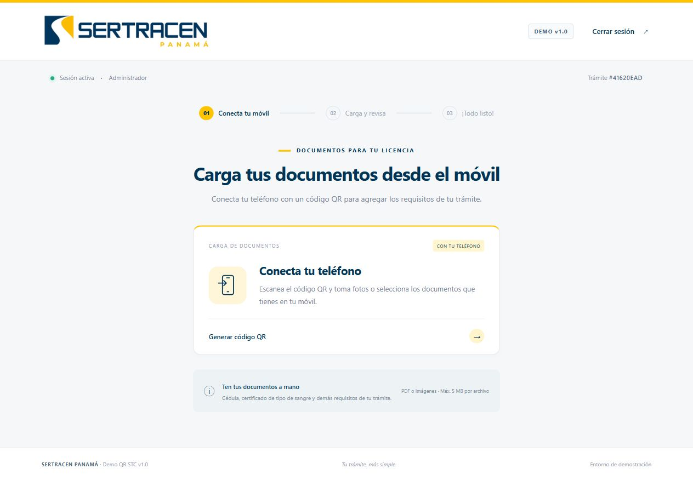
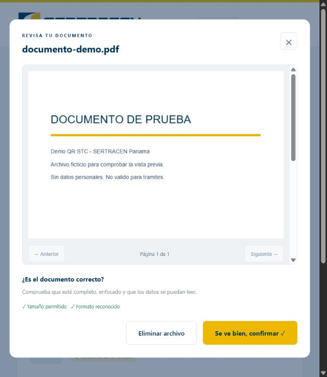

# Demo QR STC v1.0

Prototipo funcional para cargar requisitos de una licencia desde un teléfono vinculado al kiosco mediante un código QR. Interfaz en español, adaptable a escritorio y móvil, sin servicios externos para generar el QR.

## Documentación

| Guía | Contenido |
| --- | --- |
| [Uso paso a paso](docs/GUIA-DE-USO.md) | Kiosco, móvil, cámara, revisión y cancelación |
| [Arquitectura](docs/ARQUITECTURA.md) | Componentes, estados, sesión compartida y límites |
| [API y configuración](docs/API.md) | Variables de entorno, todas las rutas y errores |
| [Pruebas y soporte](docs/PRUEBAS-Y-SOPORTE.md) | Suite automatizada, aceptación manual, incidencias y mejoras pendientes |

## Ejecutar

Requiere Node.js 22.13 o superior (recomendado Node.js 24) y npm.

Descargue el ZIP del repositorio desde **Code → Download ZIP** y descomprímalo, o clone el repositorio con Git. Abra una terminal en la carpeta que contiene `package.json`.

```sh
npm install
npm start
```

Abra http://localhost:3000. Credenciales de demostración: **admin / admin**.

Para desarrollo: `npm run dev`. Para las pruebas: `npm test`.

El repositorio incluye `pnpm-lock.yaml`: si usa pnpm, puede instalar con `pnpm install --frozen-lockfile`, iniciar con `pnpm start` y probar con `pnpm test`. No copie `node_modules` de otra máquina. Detenga el servidor con Ctrl+C; después de reiniciar el ordenador deberá volver a iniciarlo.

## Probar con un teléfono real

1. Conecte ordenador y teléfono a la misma red Wi-Fi.
2. Consulte la IP local del ordenador con `ipconfig` (ejemplo: `192.168.1.50`).
3. Abra el kiosco en `http://192.168.1.50:3000` en lugar de localhost. Permita el puerto 3000 en el firewall de la red privada si fuera necesario.
4. Inicie sesión, pulse **Generar código QR** y escanee el QR. No necesita iniciar sesión en el teléfono.
5. Agregue fotos o documentos, abra cada uno y confirme que se ve bien. Luego pulse **Continuar**. El kiosco mostrará **Carga Exitosa** en aproximadamente un segundo.

El QR no puede apuntar a `localhost`, porque en el teléfono sería el propio teléfono. Si el kiosco se abre en localhost, configure una URL accesible para el móvil:

```powershell
$env:PUBLIC_BASE_URL="http://192.168.1.50:3000"
npm start
```

Puede copiar `.env.example` a `.env` y cargarla con `node --env-file=.env src/server.js` (Node 20.6+). `npm start` usa las variables del entorno; no carga `.env` automáticamente. Para HTTPS use una URL pública accesible y configure `TRUST_PROXY=true` únicamente detrás de un proxy de confianza.

## Flujos

El kiosco ofrece únicamente la carga por QR. El portal actual conserva sus direcciones (`/` y `/mobile/:token`); la URL separada para el kiosco se abordará en una fase posterior.

- **Móvil:** token aleatorio de 256 bits, QR único, plazo fijo de 120 segundos controlado por el servidor. El portal permite cámara nativa, vista previa para aceptar/repetir y selección de archivos. Los estados y documentos se consultan cada 800 ms sin peticiones superpuestas.
- **Cancelación o vencimiento:** invalida el token, descarta los documentos de ese intento y devuelve el kiosco al panel. Recargar no reinicia el plazo.
- **Cerrar sesión:** destruye la sesión del kiosco, los documentos y el acceso del móvil. El botón aparece en todas las vistas autenticadas del kiosco. El portal móvil usa el token y ofrece Cancelar; no expone la sesión administrativa.
- **Carga Exitosa:** conserva el resumen hasta cerrar sesión o iniciar un nuevo trámite.

La cámara usa un selector `capture="environment"`, compatible con navegadores móviles que ofrecen captura nativa; algunos navegadores permiten elegir cámara o galería. No requiere `getUserMedia`. La cámara y el selector de archivos se ofrecen en el portal móvil; el kiosco solo genera el enlace y muestra el estado. La previsualización de HEIC/HEIF depende del navegador; PDF, JPG, PNG y WebP son las opciones más interoperables.

## Estructura

```text
public/
  index.html          Estructura y diálogo de revisión de fotos
  styles.css          Interfaz de kiosco y móvil
  brand.css           Marca SERTRACEN Panamá
  documents.css       Miniaturas y vista previa
  assets/             Logo proporcionado
  app.js              Estados de pantalla, carga y polling
src/
  app.js              Rutas, autenticación, multipart, QR y seguridad básica
  documents.js        Reconocimiento de formato y huellas SHA-256
  store.js            Sesión de trámite, tokens, vencimiento y documentos
  server.js           Inicio del servidor
test/
  api.test.js         Pruebas HTTP de los flujos completos
  store.test.js       Pruebas de caducidad, aislamiento y revocación
  documents.test.js   Pruebas de formato y duplicados
  review.test.js      Pruebas de vista previa, revisión y eliminación
  fixtures/           PDF ficticio de demostración
.env.example
package.json
```

## API

| Ruta | Uso |
| --- | --- |
| `POST /api/login` | JSON `{ "username": "admin", "password": "admin" }` |
| `POST /api/logout` | Destruye sesión y documentos |
| `GET /api/session` | Estado del trámite autenticado |
| `POST /api/start/mobile` | Inicia plazo y devuelve QR/URL |
| `GET /api/qr` | Recupera el QR vigente sin renovar plazo |
| `POST /api/cancel` | Cancela y vuelve al panel |
| `POST /api/new` | Nuevo trámite en la misma sesión administrativa |
| `GET /api/mobile/:token` | Estado del trámite desde el móvil |
| `POST /api/mobile/:token/files` | Multipart desde el teléfono |
| `POST /api/mobile/:token/cancel` | Cancela desde el teléfono |
| `POST /api/mobile/:token/complete` | Finaliza desde el teléfono |

Todos los documentos recibidos desde el móvil pertenecen al trámite de la sesión del kiosco. Los binarios permanecen exclusivamente en memoria; la API devuelve solo metadatos. Se validan archivos no vacíos y un máximo de **5 MiB (5 × 1024 × 1024 bytes) por archivo**, en cliente y servidor. Se admiten PDF e imágenes JPEG, PNG, WebP, HEIC y HEIF; hasta 20 documentos por trámite (100 MiB máximo). Un lote inválido se rechaza completo.

## Alcance del demo y QA

Las pruebas verifican autenticación, sesión compartida, límites exactos de tamaño, finalización, cancelación, revocación de QR, aislamiento, vencimiento y rechazo de mutaciones de otro origen. Prueba manual recomendada: dos navegadores/dispositivos en la misma red; revisar captura nativa, repetición de foto, conectividad Wi-Fi y cancelación durante la carga.

La carga incluye miniaturas de imágenes, un visor PDF local con navegación por páginas, eliminación de archivos y confirmación visual de cada documento antes de finalizar. Los duplicados se detectan por SHA-256 y se rechazan aunque cambie el nombre. La API de contenido exige la sesión propietaria o el token vigente. Los nuevos controles son `GET /api/files/:fileId/content`, `POST /api/files/:fileId/review` y `DELETE /api/files/:fileId`, con sus equivalentes bajo `/api/mobile/:token/files`.

La validación técnica comprueba tamaño y firmas/estructura básica del contenedor binario (cabecera y terminación cuando corresponde). No garantiza autenticidad, contenido legal ni que el documento sea el requisito correcto. La revisión visual es una confirmación del usuario. Si el navegador no puede mostrar HEIC/HEIF, debe sustituirse por JPG, PNG o WebP. El visor PDF.js de Mozilla se sirve desde la instalación local, sin CDN, y permite detectar PDFs ilegibles o protegidos al abrirlos.

Los archivos, enlaces y sesiones se pierden al reiniciar. La cookie de sesión vence tras 30 minutos de inactividad; una limpieza periódica elimina trámites abandonados. El demo está diseñado para una única instancia y usuarios de prueba. No incluye persistencia, antivirus, verificación de autenticidad documental ni autenticación productiva. Use documentos ficticios. Para un despliegue real se requieren HTTPS, autenticación robusta, límites globales de recursos y almacenamiento protegido con una política de eliminación.

Repositorio: [jbgsi/Demo-QR-STC-v.1.0](https://github.com/jbgsi/Demo-QR-STC-v.1.0).

## Vista previa




