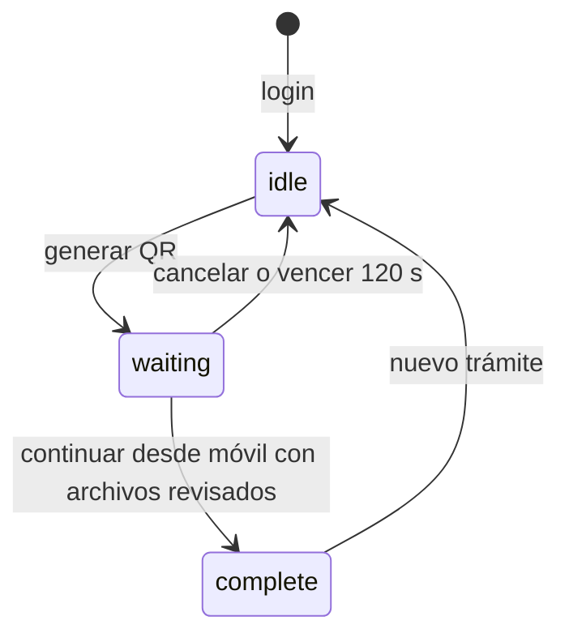

# Arquitectura y decisiones

## Componentes

| Componente | Responsabilidad |
| --- | --- |
| `public/index.html` | Cabecera compartida, contenedor de vistas, selectores y diálogos |
| `public/app.js` | Login, estados visuales, carga multipart, polling, revisión y visor PDF |
| `public/styles.css` | Diseño adaptable base |
| `public/brand.css` | Identidad visual y logo suministrado de SERTRACEN Panamá |
| `public/documents.css` | Miniaturas, visor, controles y estados de revisión |
| `src/server.js` | Arranque HTTP en todas las interfaces, puerto configurable |
| `src/app.js` | Rutas Express, cookies, autorización, Multer, QR y respuestas de error |
| `src/store.js` | Trámites, tokens, caducidad, finalización y limpieza en memoria |
| `src/documents.js` | Reconocimiento básico del contenedor y huella SHA-256 |

No hay paso de compilación del frontend, base de datos ni servicio externo de QR. PDF.js y su worker se sirven desde las dependencias locales bajo `/vendor/pdfjs`.

## Identidad y sesión compartida

El kiosco usa una cookie `stc.sid` gestionada por express-session. Al autenticar se regenera el identificador para separar la nueva sesión de la anterior. El almacenamiento administrativo es MemoryStore.

El trámite tiene un UUID visible abreviado en pantalla. Su propietario interno es el identificador de sesión del kiosco. Los documentos recibidos mediante el token móvil se guardan en ese mismo objeto. Generar otro QR inicia un intento nuevo y descarta el anterior. La subida directa desde el ordenador está retirada.

El teléfono recibe un token aleatorio de 32 bytes en la URL. Funciona como credencial temporal del trámite y no concede acceso al resto de sesiones. No debe compartirse ni persistirse. Las rutas de contenido también exigen la cookie propietaria o un token vigente.

## Direcciones y alcance de esta versión

Se conservan las rutas actuales del portal (`/` y `/mobile/:token`) y su despliegue existente. La separación del kiosco a otra URL no se implementa en este cambio. El teléfono mantiene cámara, selector de documentos, vista previa, revisión, eliminación y finalización. El kiosco genera el QR y sigue el estado.

## Estados

Un cierre de sesión elimina el trámite desde cualquier estado. La finalización revoca el token y conserva el resumen y archivos en la sesión del kiosco hasta un nuevo trámite o cierre de sesión.

## Sincronización y plazo

Ambos clientes consultan el estado cada 800 ms con peticiones sin superposición. El efecto visible suele tardar aproximadamente un segundo; depende de la red y del tiempo de respuesta. No se usa Socket.io ni long polling: esta versión implementa polling periódico sencillo.

El servidor calcula `expiresAt`. El navegador utiliza `serverTime` para compensar diferencias del reloj al dibujar la cuenta regresiva. Cada acceso al trámite verifica su vencimiento y hay limpieza periódica cada 10 segundos. Una recarga recupera el mismo QR y vencimiento. La limpieza también elimina trámites cuya sesión administrativa ya no exista.

## Archivos y validación

Los binarios se reciben y conservan en RAM con Multer. Una segunda verificación del token después de recibir el multipart evita aceptar cargas de intentos cancelados, enlaces reemplazados o vencidos y sesiones destruidas.

Se comprueban límites de tamaño/cantidad, firmas y estructura mínima de los contenedores admitidos. El tipo devuelto se obtiene del contenido y no del MIME declarado o la extensión. SHA-256 permite rechazar duplicados dentro del trámite y del lote. La incorporación del lote es atómica: no se guardan sus archivos si uno falla.

Los metadatos públicos incluyen `id`, `name`, `size`, `type` y `reviewed`; no exponen el buffer, hash interno, token ni identificador administrativo. Continuar exige al menos un archivo y que todos tengan `reviewed=true`. La revisión es una confirmación explícita del usuario, no OCR ni autenticación documental.

## Límites del prototipo

- Una instancia y memoria local: no hay persistencia ni recuperación tras reiniciar.
- Credenciales de demostración fijas y sin protección de acceso por intentos.
- El límite de 100 MiB corresponde a documentos de un trámite; no es un límite global de RAM entre sesiones o peticiones concurrentes.
- Las comprobaciones de firmas no sustituyen un decodificador completo, antivirus ni verificación de identidad o requisitos.
- No hay clasificación obligatoria de cédula/sangre, revisión por funcionario, comprobante descargable ni integración con sistemas de licencias.
- Cookie HttpOnly y SameSite Strict, política CSP, `nosniff`, rechazo de mutaciones de otro origen y ausencia de caché son controles básicos del demo, no una evaluación de seguridad productiva.

Antes de usar datos reales se requiere definir autenticación, HTTPS, almacenamiento protegido, límites globales, análisis de archivos, retención/eliminación y controles operativos. Los recursos gráficos identifican el prototipo; no implican una integración oficial con SERTRACEN.
